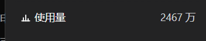
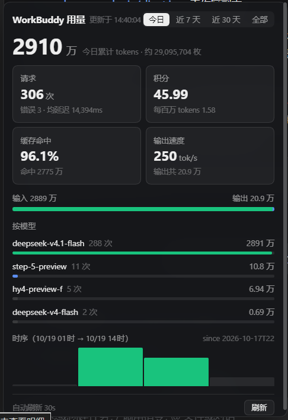

# dsh-workbuddy-usage

在 [DeepSeek Harness](https://github.com/deepseek-ai)（DSH Desktop）**左侧栏底部**加一行原生风格的「使用量」条目，点开是 Codex 统计风格的用量面板 —— 每日 Token、积分消耗、缓存命中、按模型单价、账号剩余额度，一屏看完。

> 数据来自 workbuddy2api / CodeBuddy 兼容网关自带的面板接口（`/panel/api/usage`、`/panel/api/overview`），插件只读，不改动网关。





## 功能

- **侧栏常驻条目**：`使用量 · 2467 万`，位于「远程控制」正上方；图标 + 文案 + 右对齐数值，沿用 DSH 原生行高（36px）、圆角、hover 色与折叠态（只留图标）。
- **计数单位**：Token 未破 1 亿一律按「万」（`948.1 万`），破亿按「亿」（`1.154 亿`），并自动处理 `10000 万 → 1 亿` 的进位。
- **区间切换**：今日 / 近 7 天 / 近 30 天 / 全部。
- **面板指标**：区间 Token 总量、请求数（含错误数、平均延迟）、积分（含每百万 Token 均价）、缓存命中率、输出速度、输入/输出占比条、时序柱状图。
- **按模型明细**：每个模型的请求数、Token 量，以及**每百万 tokens 的积分消耗**（`1.25 积分/M`；零消耗模型标「免费」）。
- **账号额度**：账号池总剩余 / 总额度进度条、可用 / 冷却 / 禁用数量、逐账号剩余额度迷你条与状态点，悬停可看冷却原因、最近使用模型、累计请求与套餐到期时间。
- **面板内设置**：面板右下角「设置」直接改服务器地址与 API Key，保存后写回 config.json、清缓存并自动探活，不用手改文件。
- **自动刷新**：面板收起时 3 分钟、展开时 30 秒；「刷新」按钮带 
efresh=1 绕过缓存。
- **深/浅色自适应**：按祖先背景亮度自动切换色板，全部使用 DSH 设计 token（`--dsw-alias-*`、`--dsw-radius-*`）。

## 安装

### 1. 放置插件

```bash
git clone https://github.com/xiebrooooo/dsh-workbuddy-usage.git \
  ~/.dsh/plugins/dsh-workbuddy-usage
```

（Windows 即 `C:\Users\<你>\.dsh\plugins\dsh-workbuddy-usage`）

### 2. 写配置（二选一）

**推荐：装好后在面板里填** —— 重启 DSH 后点侧栏「使用量」→ 面板右下角「设置」，填写服务器地址与 API Key，点「保存并测试」。插件会把配置写进自己的 `config.json` 并立刻验证连通性，无需手改文件。

**或者：先手写配置文件**

```bash
cd ~/.dsh/plugins/dsh-workbuddy-usage
cp config.example.json config.json
# 编辑 config.json：填 baseUrl 与 apiKey
```

`config.json` 已被 `.gitignore` 忽略，不会误提交。

### 3. 挂进 profile

编辑 `~/.dsh/profiles/desktop/package.json`：

```json
{
  "dependencies": {
    "dsh-workbuddy-usage": "file:../../plugins/dsh-workbuddy-usage"
  },
  "dsh": {
    "profile": {
      "bundles": [
        "@deepseek-ai/dsh-base",
        "@deepseek-ai/dsh-web-app",
        "dsh-workbuddy-usage"
      ]
    }
  }
}
```

然后在 profile 目录执行：

```bash
cd ~/.dsh/profiles/desktop
pnpm install
```

### 4. 重启 DSH Desktop

宿主半侧是 ESM 模块，改完**必须重启一次**才会加载；客户端半侧之后可热更新。

重启后左下角「远程控制」上方会出现「使用量」条目。

## 配置

`config.json`（可用环境变量 `WORKBUDDY_USAGE_BASE` / `WORKBUDDY_USAGE_KEY` 覆盖前两项）：

| 字段 | 默认值 | 说明 |
|---|---|---|
| `baseUrl` | `http://127.0.0.1:7863` | 网关地址，含 scheme 与端口，不带尾斜杠 |
| `apiKey` | — | 面板 API Key（`Authorization: Bearer`） |
| `routePrefix` | `/dsh-workbuddy-usage` | 注册到 DSH webServer 的前缀路由 |
| `cacheTtlMs` | `25000` | 用量数据缓存 |
| `accountTtlMs` | `60000` | 账号额度缓存 |
| `timeoutMs` | `20000` | 上游请求超时 |

## 路由（由宿主半侧注册到 DSH 同源 webServer）

| 路径 | 说明 |
|---|---|
| `GET {routePrefix}/api/usage?scope=today\|7d\|30d\|all[&refresh=1]` | 用量 + `account` 账号数据 |
| `GET {routePrefix}/api/account[?refresh=1]` | 仅账号额度与状态 |
| `GET {routePrefix}/api/config` | 读取当前配置（**不返回 Key 明文**，只给 `hasApiKey` 与 `apiKeyHint`） |
| `POST {routePrefix}/api/config` | 保存 `{ baseUrl, apiKey?, timeoutMs? }`，写回 `config.json`、清缓存并立刻探活 |
| `GET {routePrefix}/api/ping` | 连通性 / 配置自检（不含 Key） |

### 为什么必须有宿主半侧

面板响应带 `Content-Security-Policy: connect-src 'self'`、`Cross-Origin-Resource-Policy: same-origin`，且没有 `Access-Control-Allow-Origin`，浏览器无法直连。因此由宿主进程（Node）带 Bearer 拉取上游，再以**同源**前缀路由提供给渲染进程。

## 数据字段

上游 `by_model[]` / `totals` 每条记录会被规范化为：

```json
{
  "requests": 306, "errors": 3,
  "promptTokens": 28890000, "completionTokens": 209000, "totalTokens": 29095704,
  "credits": 45.99, "creditTokens": 29095704, "creditsPer1M": 1.58,
  "cacheHitTokens": 27750000, "cacheMissTokens": 1345704, "cacheHitRate": 96.1,
  "avgLatencyMs": 14394, "tokensPerSecond": 250
}
```

账号侧来自 `/panel/api/overview`：`totals{accounts,healthy,cooling,paused,disabled,credits,creditsTotal}` 与 `accounts[]{uid,nickname,realm,credits,creditsTotal,cooling,disabled,until,reason,lastModel,requests,totalTokens,earliestExpiry,earliestRemaining}`。

## 开发与调试

- 客户端 bundle 由宿主 `@deepseek-ai/dsh-client-hmr` 每 500ms 轮询 `mtime/size`，变化即重新发布并经 SSE `/plugins/events` 推送 —— **改 `client.js` 后无需重启 DSH**。
- 但 pnpm 对 `file:` 依赖是**复制**而不是软链：`~/.dsh/profiles/desktop/node_modules/dsh-workbuddy-usage/` 里是副本，**页面加载的是副本**。改完源码必须同步：

  ```bash
  cp client.js ~/.dsh/profiles/desktop/node_modules/dsh-workbuddy-usage/client.js
  ```

- 改 `index.js`（宿主半侧）没有热更新，重启 DSH 才生效。
- 快捷验证：`curl -H "Authorization: Bearer $KEY" "http://127.0.0.1:7863/panel/api/usage?hours=24"`。

## 排错

| 现象 | 原因 / 处理 |
|---|---|
| 侧栏没有「使用量」 | profile `bundles` 未包含本包，或没执行 `pnpm install`，或没重启 DSH |
| 面板显示「上游 401」 | `apiKey` 与面板 `api_key` 不一致 |
| 面板显示「HTTP 404」 | 宿主半侧未加载（检查 bundles / 重启） |
| 改了界面没变化 | 忘了同步 `node_modules` 里的副本（见上） |
| 数字不更新 | 路由层有 25s 缓存，点「刷新」走 `refresh=1` |
| 「设置」保存后提示失败 / 404 | 宿主半侧改过代码但没重启 DSH（index.js 无热更新） |
| 账号额度区块不显示 | 宿主半侧未重启；或上游 `/panel/api/overview` 不可用（面板会显示原因） |

## 兼容性

- DSH Desktop 2.0.x（Web 客户端，`http://127.0.0.1:43120`）。
- 依赖的槽位：`sidebar.footer.action`（`order: 25`，原生「远程控制」为 `26`）。
- 上游需提供 `/panel/api/usage` 与 `/panel/api/overview` 且支持 Bearer 鉴权（workbuddy2api 面板即满足）。

## 免责声明

第三方社区插件，与 DeepSeek / CodeBuddy 官方无关。插件只读取你自己网关的面板接口，不收集、不上传任何数据。

## License

[MIT](LICENSE)
